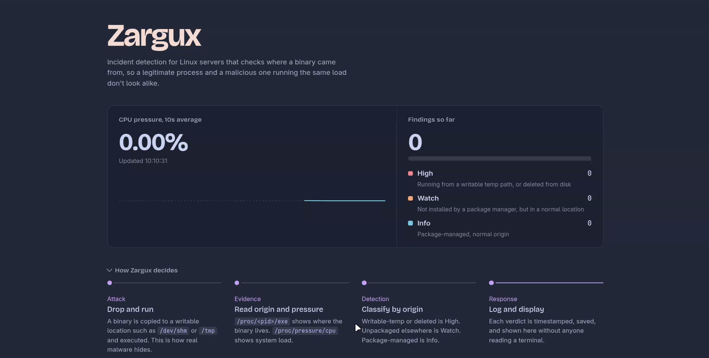

# Zargux

A linux incident detection tool made in Python.

Mainly intended as a CLI Tool but now can be used as a Web Dashboard too for monitoring.

## github link for project submission

https://github.com/abhyuday-fr/Zargux

## Screenshot



## Build

Although in the docs, everything is given already but just for a quick overview:

1. The attack and detection both are simulated on a multipass Ubuntu VM.

2. Run this for attack simulation:
  ```bash
  sudo python3 zargux.py demo
  ```

3. In another terminal, run:
  ```bash
   python3 -m http.server 8000
  ```

  and open localhost:8000 in your browser and see the mointoring dashboard live.
